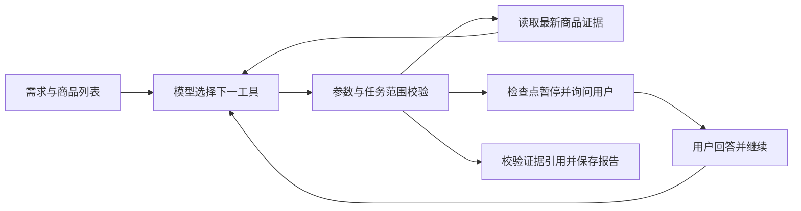

# 购物研究 Agent：首个闭环

2026-10-28 用户确认调整开发主线：尽早运行真实 Agent，由任务需要推动采集工具完善，不等待所有平台字段采集完整后才接入模型。首版仍包含淘宝、京东、不同品类和跨品牌替代搜索。

## 当前实现与边界

任务详情新增“购物研究助手”。用户输入用途、条件与问题后，后台调用现有 Chat Completions 兼容网关；模型选择工具，程序校验并执行，工具结果返回模型，由模型决定继续读取、追问或提交结果。

当前开放的真实工具包括：

| 工具 | 实际动作 | 边界 |
| --- | --- | --- |
| `read_product_evidence` | 按任务内商品 ID 读取最新快照、字段、价格原文、覆盖与证据 | 不跨任务读取；无快照明确返回缺失；用户重采集后可以重读 |
| `capture_product_page` | 请求扩展重新读取已打开的同一商品页，保存新快照并把新证据返回模型 | 不打开或刷新页面，不改变规格；超时、页面变化和扩展错误均返回失败 |
| `collect_product_page` | 默认采集工具，后台独立 Chromium 打开任务商品链接、等待和滚动、保存新快照并返回证据 | 不依赖扩展或用户打开商品页；登录/验证明确受阻，不切换规格或操作购买 |
| `inspect_product_variants` | 读取当前可见规格分组、选项编号、选中与禁用状态，保存目录快照 | 限定数量、保留证据；目录缺失/歧义时不假定可以选择 |
| `select_product_variant` | 按已读取目录 ID 受控选择，核对选中状态及同页价格稳定后保存新证据 | 校验归属与新鲜目标，不操作购买；同页价格不等于 SKU 最终支付价 |
| `ask_user` | 提出影响判断的关键问题，通过 LangGraph interrupt 保存并暂停 | 回答作为用户陈述；用户可先用扩展重新采集再回答 |
| `submit_report` | 提交摘要、逐条发现及引用、未知项 | 程序检查已读取所有初始商品与引用存在性；无效引用退回模型修正 |

## 研究结果的证据与呈现

报告输出包含结论、逐条带证据引用的发现和待核实项。模型指引要求结论先回答用户问题，再限定已核实的共同规格和比较范围；对于价格，只在同价格口径时给出差额，只在两边长度都已核实时给出每米页面标价。优惠前价不能写成到手价，价格优势不能单独推出整体性价比；不同颜色或选项不能称为完全相同。商品选项中的材质与性能词仍是商家文案，除非有独立参数证据。

工作台将结果分成结论、编号发现和待核实项，展开每条发现可查看原始证据摘录。历史文本中的字面量 `\n` 会在前后端兼容层转换成实际换行，不修改已经保存的历史记录。此处理改善可读性和表达边界，但不是事实校验器；下一阶段仍应让程序对来源明确的金额和单位价格做确定性计算，避免只依赖模型算术。

2026-10-28 真实商品运行 `f791b5ff-f2ad-46f2-a888-b2b9b88e7349` 已比较山泽白色与绿联灰白色两款 15 米扁平网线：报告正确把共同维度限定为六类千兆、长度及扁线形态，保留选项差异，并计算优惠前标价差 ¥3.23（以 ¥55.60 为分母约 5.81%）、每米差约 ¥0.22；两款材质/电气细节及最终支付价仍未知。这是单次真实结果验收，不能据此宣称普遍准确。

引用采用 `snapshot_id:evidence_id`，用户补充采用 `user:run_id:序号`。引用存在性不等于事实判断正确；商家描述、用户陈述及模型解释仍需区分。页面内容作为资料，不能改变工具权限。图片只保存来源及尺寸，当前模型没有阅读图片内容。

真实任务反馈发现两种过度推断：模型把“优惠前价”改写成“起售价”，把未识别选中规格解释成用户未选择规格。现已在模型指令与工具返回的 `observation_limits` 中明确语义边界；价格与目标规格能否对应未知时，只能保留未知。此措施不构成对所有自由文本事实的程序证明，仍需真实结果验收。

重复读取会返回 `freshness=same_snapshot`，明确没有访问商品页或获得新证据。报告新增 `outcome`，资料不足时为 `needs_evidence`，前端标记阶段性结果；旧报告兼容按阶段性结果展示，不改写其原始内容。

当前默认后台 `collect_product_page` 独立打开商品页；安装与验证见 [后台采集说明](BACKGROUND_COLLECTION.md)。后台与扩展两通道各有每研究 3 次上限；后台默认 55 秒、6 次滚动、最多 2 个浏览器，保存前核对运行状态，已提交快照按工具调用幂等重放。图片阅读和搜索替代品尚未实现。

规格核验工具现已接入：采集/目录读取共享 3 次上限，选择另最多 3 次。模型根据目录 ID 请求选择，程序重新观察目标、原生点击、等待并核对选择结果，返回独立的规格核验状态。共享适配器已覆盖当前新版天猫；实页读取 2 组 26 个选项，选择10米目标成功；真实网关合成联调 5 次调用、47.07 秒，引用选择后快照。最新真实暂停研究也已通过目录→选择→报告链路完成。详见 [自动规格核验](AUTOMATIC_VARIANTS.md)，跨品类、京东实页与推荐质量继续分别验收。

以下为扩展接管通道及此前交付记录：扩展 `0.2.0` 已接入受控补采集，匹配商品页每约 4 秒领取请求。请求最多等待 75 秒，每次租约 30 秒，最多领取 2 次；每研究最多 3 次。后台校验商品身份、凭据、时间和载荷，快照及完成状态原子保存；重放不重复写入，凭据仅存哈希。等待占用一个工作线程，取消拒绝后续结果，重启显式继续复用请求。

后台已在私有 SQLite 备份后重启加载迁移 `20261028_0004`，健康状态 ready。实际使用需要在 Chrome/Edge 扩展管理页重新加载 `0.2.0`，再刷新商品页和工作台。无需每次手动点加入；Agent 发起补采集后，匹配页面的扩展会回传新快照并自动继续。解析器仍可能缺字段，不能把通道成功等同于采集完整。

后续 `0.2.1` 补充扩展连接诊断：最近 90 秒的通信、版本与错误；连接观察为有界短期内存记录，重启后需等下一次通信。仅此扩展通道需要商品页内容脚本。工作台现将其列为可选接管，后台采集无需扩展连接。

## 执行与持久化

- LangGraph 状态图使用 SQLite checkpointer；`agent_runs` 保存需求、状态、模型、事件、问题、报告和错误。检查点文件与业务数据库位于相同私有数据目录。
- 单服务进程使用两个工作线程。每任务最多一个排队、执行、等待确认或中断的运行；创建请求有幂等键，重复点击不创建第二个运行。
- 每个运行最多 24 次模型请求、3 次人工确认；每次执行片段最多 180 秒。模型网关请求默认 60 秒，可通过 `SHOPPING_AGENT_LLM_TIMEOUT_SECONDS` 调整（上限 90 秒）；连接失败、HTTP 错误和请求超时会分别提示。人工等待不占工作线程。
- 服务重启后，执行/排队状态标记为中断，用户明确继续后读取检查点。没有声称分布式调度或外部动作恰好执行一次。
- 停止会持久化取消状态；在途 HTTP 请求返回后停止，不再推进图。删除任务会清除运行记录和检查点，正在执行的线程结束时再次清理，避免重新留下已删除任务的检查点。
- 本地运行事件保留模型实际输入、工具选择、工具参数/结果、耗时、错误和返回的用量。密钥、认证头及隐藏推理不记录；运行数据含用户需求与商品资料，不进入 Git。
- 工作台将研究步骤显示在固定高度的内滚列表中，运行时跟随最新步骤；每步调用记录通过弹窗按消息、参数、结果和用量格式化展示，并可切换查看完整原始 JSON。长上下文与大型结果默认折叠。
- 研究功能会把需求和读取的文字证据发送到配置的网关；界面在开始按钮旁明确说明。原有命名功能仍只发送页面标题。

API：`POST/GET /api/v1/tasks/{task_id}/research`，以及 `POST /api/v1/tasks/{task_id}/research/{run_id}/resume`、`/cancel`。历史记录和刷新后的结果来自持久化数据库。模型和工具执行器见 [research_agent.py](../backend/app/research_agent.py)，网页入口见 [ResearchPanel.tsx](../frontend/src/ResearchPanel.tsx)。

## 已有证据与未验收项

- 新增 7 项检查覆盖暂停重启恢复、错误引用修正、失败重试与幂等、跨任务拒绝和循环上限、取消后禁止继续，以及同快照重读语义和旧报告结果兼容；与原有 8 项 API 测试合计 15 项。
- 真实配置网关使用合成商品资料和临时数据库，完成 `read_product_evidence → ask_user → submit_report`，3 次模型调用，24.2 秒。中途回答后恢复成功，最终状态 completed；这是单次协议/流程探针，不是准确率或性能结论。
- 语义修正后用合成数据再次调用真实网关：3 次调用、24.4 秒，报告 outcome 为 needs_evidence，保留“优惠前”原文，明确价格与目标规格的对应关系未知，并区分用户陈述与页面证据。未声称已经重采集或得知最终价。
- 网页类型检查、网页及 Chrome/Edge 扩展构建通过。先前 Windows Node 原生模块阻塞已通过找到并使用现有 WSL Node 24 解除，没有重装前端依赖。
- 补采集新增 7 项后台集成测试，后台合计 22 项通过；扩展通道 6 项检查通过，涵盖无请求不读取、凭据匹配、回传重放、执行前后导航和适配器异常。后台还验证租约接管、错误商品、取消、超时、旧采集时间和服务重启后的同请求恢复。
- 真实模型 + 合成资料 + 模拟扩展联调通过：`read_product_evidence → capture_product_page → submit_report`，3 次模型调用、25.68 秒，报告引用新快照。该探针不代表 Windows 扩展验收。Windows 自动化因 Computer Use 无法可靠确定当前浏览器 URL 而停止，实际重载与商品页验收待用户执行。
- 尚待用户用真实商品完成研究体验验收；两平台字段覆盖、实际推荐质量、图文理解和自主替代品搜索未通过验收。现有天猫快照仍可带着缺项进入研究。

## 学习伴读

数据流：React 提交需求 → API 建立持久化运行 → LangGraph 调用模型 → 模型输出工具名/参数 → Pydantic 校验 → 读取任务内证据或暂停 → 工具结果再次给模型 → 校验报告并保存。

关键概念：工具 Schema 描述可调用动作；工具返回值是下一轮模型的观察；检查点保存执行位置；运行事件记录发生过什么；两者职责不同。固定图边负责约束运行，模型根据观察选择工具。

修改练习：增加一个只读取已有证据的工具，并比较模型在什么情况下选择它。失败案例：把报告引用改成不存在的 `snapshot:e999`，解释为什么系统要把错误返回模型，而不是显示报告成功。对应测试见 [test_research_agent.py](../backend/tests/test_research_agent.py)。

网关探针可在 WSL 后台目录执行 `uv run python -m scripts.probe_research_agent`，只使用合成输入和临时数据库，调用真实配置的模型。LangGraph 行为依据 [持久化文档](https://docs.langchain.com/oss/python/langgraph/persistence) 和 [interrupt 文档](https://docs.langchain.com/oss/python/langgraph/interrupts)。
